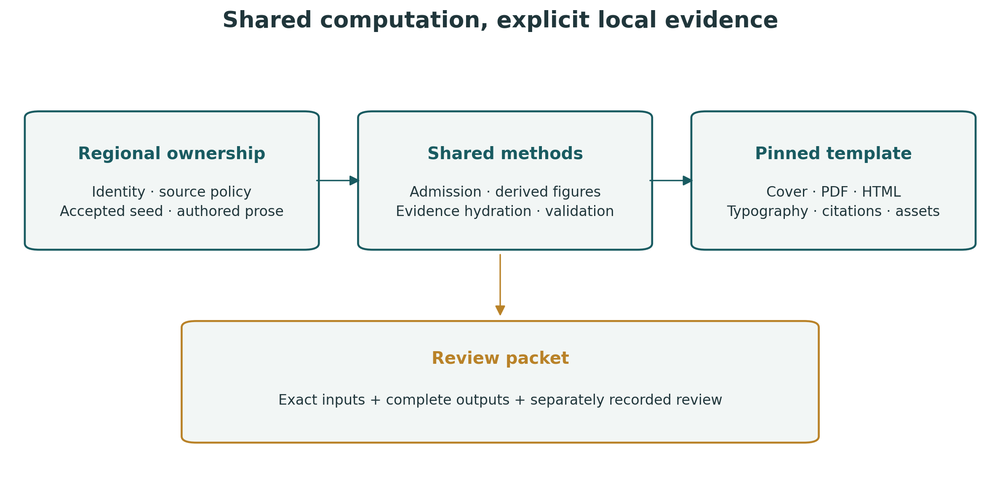

# Regional civic intelligence through shared methods and explicit local policy

## Scope

A regional civic-intelligence system must distinguish reusable computation from
local source selection and from the evidence produced by a particular run.
Region Intel implements that separation as a shared Bun/TypeScript package
consumed by independently configured municipal repositories. This methods
manuscript describes the architecture; it introduces no empirical finding about
source completeness, legal correctness or hazard absence.

## Research question and contribution

The engineering question is whether one implemented method can be reused while
keeping source identity, operating policy, accepted evidence and interpretation
attributable to a locality. Shared code addresses duplication; it does not make
two jurisdictions empirically interchangeable. The contribution is the explicit
boundary and its executable admission/replay checks, rather than a demonstrated
civic effect.

The diagram is generated by the shared figure producer; its [vector version](assets/method-architecture.svg)
is available for inspection. A regional manuscript's measured figures instead
derive from that region's accepted seed and retain their numerical fallbacks.

## Configuration and provenance

A civic profile declares jurisdiction identity, timezone, geographic anchor,
municipal-code provider, corpus namespace and publication identity. A regional
policy declares provider parameters. A deployment binds both documents to a
consumer repository, selects sources and enables individual monitors. Runtime
admission validates the binding before acquisition. Output ownership receipts
prevent an alternate profile from adopting retained data belonging to another
jurisdiction. Package assets and methods resolve from the installed dependency;
regional configuration, seeds and producer output resolve from the consumer.

## Acquisition and analysis

Provider adapters use bounded transport, source-specific validity rules and
explicit health states. Schema validation, source hashes and custody receipts
support reproducible derived artifacts. Municipal-code acquisition, verification
and export feed corpus search, citation analysis, readability and optional
retrieval-augmented generation. Geographic policy filters provider observations;
a parameter or source URL alone does not establish local coverage.

## Publication

A deployment publishes a bounded view of retained observations and selected
sources. Public projections exclude operator diagnostics and private paths.
Configuration identity, source availability and publication integrity are
separate checks. A source catalog is visibly uncollected until a producer has
emitted evidence. Repeated retrieval cannot freshen an old observation product.

## Scholarly positioning

The [primary-source reading record](scholarship.md) separates ten contextual
references from project-specific claims. PROV-DM motivates distinct entity,
activity and responsibility records. Dataset documentation motivates explicit
composition, intended-use and generalization boundaries. Open-government data
research cautions against assuming public value merely because records are
opened. Reproducibility guidance motivates retaining code/data links, while legal
AI research motivates a separate task-specific evaluation of generated answers.
None supplies a substitute for regional observations or a human user study.

## Native publication and exact numerical fallbacks

The regional backend imports the actual pinned docxology/template APIs.
The template owns native cover/front-matter, PDF/HTML composition, citation
rendering and the complete offline reader. Region Intel owns captured regional
inputs, the descriptive article-level profile, Matplotlib figure production,
projection and transactional member/hash checks. Consumers own the prose,
accepted public evidence, source declarations and artwork metadata.

The article/section distribution is a description of source segmentation.
It does not measure legal importance, regulatory burden or resident experience.
The full CSV and profile JSON make the chart independently inspectable, and
conceptual diagrams and AI-generated cover illustrations remain visibly distinct
from that measured data.

## Cross-region validation

The shared gate validates source and test types, contracts, the offline suite,
output fences and measured coverage. Consumer checks exercise the installed
package, identity-policy binding, cross-region rejection and publication.
Davis provides an inland configuration distinct from the coastal Crescent City
reference deployment. Live provider checks, native browser journeys, external
manuscript rendering and hosted delivery require their own receipts; a shared
package test cannot establish them by implication.

## Reproducibility and limitations

Consumers pin a full Git commit and retain a frozen dependency lock. The
reference manuscript in `docs/manuscript/` retains its original claim ledger and
Crescent-specific input scope. It must not supply numerical findings for Davis.
Optional model services, upstream access restrictions, source rights and
jurisdiction-specific adapters remain explicit operational prerequisites.
